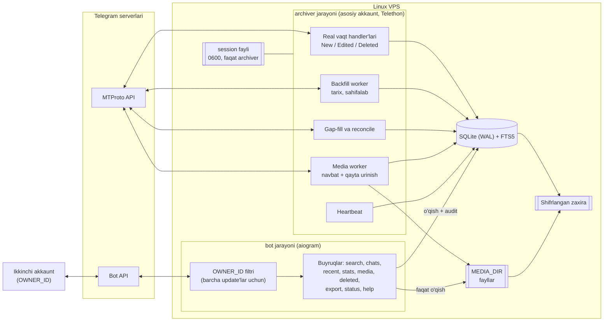
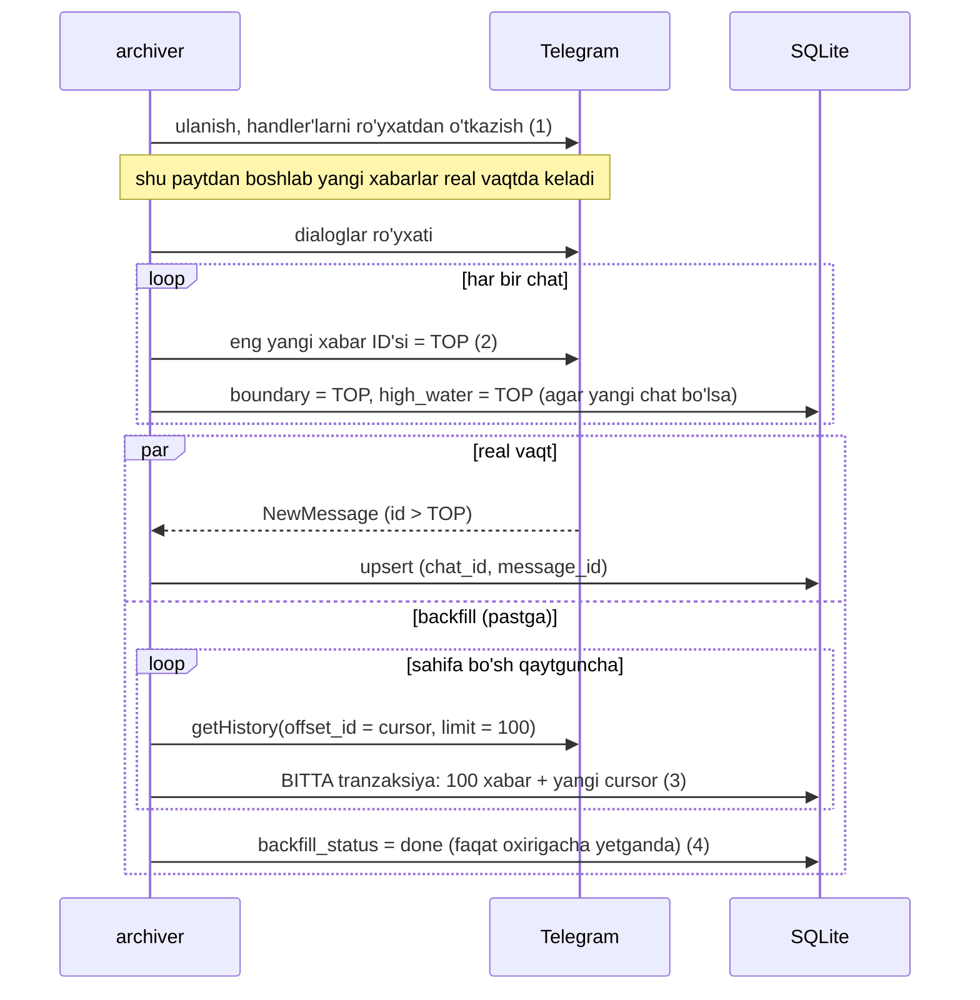

# 2-bosqich. Arxitektura va texnologiyalar tanlovi

## 1. Umumiy ko‘rinish



Matnli ko‘rinish (terminal uchun):

```
  Telegram MTProto                                      Telegram Bot API
        ^                                                      ^
        |  session (auth key)                                  |  BOT_TOKEN
+-------+-----------------------------+          +-------------+-------------+
| archiver  (asosiy akkaunt A)        |          | bot  (aiogram)             |
|  - real vaqt: new/edit/delete       |          |  - OWNER_ID filtri          |
|  - backfill: tarix, sahifalab       |          |  - /search /chats /stats    |
|  - gap-fill / reconcile             |          |    /media /deleted /export  |
|  - media worker (navbat)            |          |  - session YO'Q             |
|  - heartbeat                        |          +-------------+---------------+
+-------+-----------------+-----------+                        |
        | yozish          | fayllar                o'qish      | (+ audit)
        v                 v                                    v
   +-----------------------------+    +------------------------------+
   | SQLite WAL + FTS5           |<---| bot ham shu bazani o'qiydi    |
   +-----------------------------+    +------------------------------+
        |        MEDIA_DIR (bot uchun faqat o'qish)
        v
   shifrlangan zaxira (10-bosqich)          Ikkinchi akkaunt B <---> bot
```

## 2. Komponentlar va javobgarlik

| Komponent | Vazifa | Kirish huquqi |
|---|---|---|
| **archiver** | Asosiy akkaunt bilan MTProto ulanishi; tarix importi, real vaqt hodisalari, media yuklash | session, `TG_API_HASH`, baza (yozish), `MEDIA_DIR` (yozish) |
| **bot** | Ikkinchi akkaunt uchun boshqaruv interfeysi | `BOT_TOKEN`, baza (o‘qish + audit/sozlama yozish), `MEDIA_DIR` (faqat o‘qish). **Session va API_HASH yo‘q** |
| **SQLite** | Yagona haqiqat manbai: xabarlar, versiyalar, holatlar, audit | ikkala jarayon |
| **CLI** (`tgarchive`) | Migratsiya, konfiguratsiyani tekshirish, keyinroq login/backup | operator |

**Nega ikkita alohida jarayon?** (1) Xavfsizlik: bot buzilsa ham session'ga yetib bo‘lmaydi. (2) Nosozlik izolyatsiyasi: bot qayta ishga tushsa, arxivlash to‘xtamaydi. (3) Har birini alohida yangilash va kuzatish oson.

## 3. Texnologiyalar tanlovi

Versiyalar 2026-10-25 da PyPI'dan tekshirildi va bitta venv'da birga o‘rnatilib, testlar o‘tkazildi.

### 3.1. MTProto kutubxonasi

| Variant | Holati (tekshirildi) | Xulosa |
|---|---|---|
| **Telethon 1.45.0** | Reliz 2026-09-10. Repozitoriy Codeberg'ga ko‘chgan (GitHub 2026-02-21 da arxivlangan). README: *"v1 is for the most part in maintenance mode. New layers are still updated to when released, bug fixes are welcome"*. So‘nggi commit "Update to Layer 232" — 2026-10-21. | **Tanlandi.** Eng to‘liq hujjat, `iter_messages` (offset/min_id/reverse), `MessageDeleted`/`MessageEdited` hodisalari, takeout, FloodWait boshqaruvi. |
| Pyrogram 2.0.106 | Repozitoriy 2024-12-23 da arxivlangan, README: loyiha qo‘llab-quvvatlanmaydi. So‘nggi reliz 2023-aprel. | Yaroqsiz: yangi Telegram layer'lari kelmaydi. |
| Kurigram 2.2.26 / Pyrofork 2.3.69 | Pyrogram'ning jamoaviy fork'lari, faol relizlar | Mumkin, lekin hujjat va barqarorlik kafolati Telethon'dan past. |
| TDLib (rasmiy C++ kutubxona) | Rasmiy, to‘liq | Bu loyiha uchun og‘ir: o‘z bazasi, native build, Python wrapper'lar uchinchi tomondan. |

**Xavf va uni kamaytirish.** Telethon v1 "maintenance mode" da. Shuning uchun Telethon kodi faqat archiver adapter qatlamida bo‘ladi; saqlash qatlami oddiy `MessageRecord` ni qabul qiladi ([store.py](../src/tgarchive/db/store.py)). Kelajakda kutubxonani almashtirish faqat adapterga ta’sir qiladi.

### 3.2. Qolgan stack

| Qatlam | Tanlov | Versiya | Sabab |
|---|---|---|---|
| Python | CPython | 3.12 | Barcha kutubxonalar qo‘llab-quvvatlaydi; Docker `python:3.12-slim` |
| Shifrlash tezlatgichi | cryptg | 0.6.0 | Telethon uchun tezkor AES (ixtiyoriy, lekin tavsiya) |
| Bot | aiogram | 3.31.0 | Zamonaviy async, router/middleware, inline keyboard, FSM |
| ORM | SQLAlchemy (asyncio) | 2.1.6 | Typed modellar, partial index, ikki bazaga mos |
| SQLite drayver | aiosqlite | 0.22.1 | asyncio uchun |
| Migratsiya | Alembic | 1.20.1 | Sxema tarixini boshqarish, SQLite batch rejimi |
| Konfiguratsiya | pydantic-settings | 2.16.1 | Tiplangan, `SecretStr`, .env |
| Validatsiya | pydantic | **2.13.5** | aiogram 3.31.0 `pydantic<2.14` talab qiladi — shuning uchun eng yangi 2.14.1 emas |
| Log | structlog | 26.1.0 | JSON structured log, stdlib bilan integratsiya |
| Vaqt mintaqalari | tzdata | 2026.5 | Windows va slim konteynerlarda tizim tz bazasi yo‘q |
| Test | pytest + pytest-asyncio | 9.1.1 + 1.4.0 | — |

To‘liq lock (tranzitiv bog‘liqliklar + sha256 hash): [requirements.txt](../requirements.txt), [requirements-dev.txt](../requirements-dev.txt).

### 3.3. SQLite yoki PostgreSQL?

**Qaror: SQLite (WAL rejimi + FTS5) bilan boshlaymiz.** PostgreSQL hozir ortiqcha murakkablik.

SQLite yetarli, agar:

- Bazaga yozuvchi **bitta** jarayon (archiver); bot asosan o‘qiydi — WAL bunda o‘quvchilarni to‘smaydi.
- Hammasi bitta serverda.
- Hajm taxminan **< 50–100 mln xabar / < 100 GB** (media fayllar bazadan tashqarida).
- Zaxira: SQLite online backup API — xizmatni to‘xtatmasdan.

PostgreSQL'ga o‘tish vaqti keldi, agar:

- Bir nechta yozuvchi jarayon yoki server kerak bo‘lsa (masalan, bir nechta akkaunt alohida worker'larda).
- Ko‘p foydalanuvchili veb-interfeys yoki og‘ir analitik so‘rovlar kerak bo‘lsa.
- Replikatsiya yoki point-in-time recovery talab qilinsa.
- Baza 100 GB dan oshsa yoki qidiruv sekinlashsa.

O‘tish yo‘li: modellar ikkala bazaga mos yozilgan (`BigInteger`, partial index'lar `postgresql_where` bilan). Faqat FTS qismi almashtiriladi (`tsvector` / `pg_trgm`) va ma’lumot ko‘chirish skripti yoziladi.

### 3.4. Docker yoki systemd?

**Qaror: Docker Compose** (egasi qarorni menga qoldirdi, [01-requirements.md, 1.6](01-requirements.md#16-egasi-qarorlari-2026-10-25)).

| Mezon | Docker Compose | systemd + venv |
|---|---|---|
| Python versiyasi OT'dan mustaqil | ✅ | ❌ (distro'ga bog‘liq) |
| Avtomatik qayta ishga tushish | `restart: unless-stopped` | `Restart=always` |
| Healthcheck | o‘rnatilgan | timer/skript kerak |
| Izolyatsiya | bot konteyneriga session volume ulanmaydi; non-root, read-only FS | `ProtectSystem=`, alohida user |
| Birinchi login (telefon kodi) | `docker compose run --rm archiver tgarchive login` | `tgarchive login` |
| Qo‘shimcha qatlam | Docker o‘rnatish kerak | yo‘q |

## 4. Ichki tuzilma

```
src/tgarchive/
  config.py          sozlamalar (BaseAppSettings / ArchiverSettings / BotSettings)
  logging_setup.py   structlog + maxfiy qiymatlarni yashirish
  fs.py              umask 077, 0700 kataloglar, ruxsat tekshiruvi
  cli.py             tgarchive check-config | db-upgrade | db-info
  db/
    engine.py        Database: WAL, BEGIN IMMEDIATE, read()/write()
    models.py        jadvallar
    store.py         saqlash mantiqi (Telethon'ga bog'liq emas)
    fts.py           FTS5 qidiruv, o'zbekcha tutuq belgisi normallashtirish
    migrate.py       Alembic'ni dastur ichidan ishlatish
  migrations/        Alembic (paket ichida — Docker'da ham ishlaydi)
  archiver/          5–8-bosqich: Telethon adapter, backfill, realtime, media
  bot/               9-bosqich: aiogram router'lar, middleware
```

Qatlamlar qoidasi: `db/` hech qachon `telethon` yoki `aiogram` ni import qilmaydi. `archiver/` va `bot/` faqat `db/store.py` va `config.py` orqali ishlaydi.

## 5. Sinxronlash strategiyasi

Maqsad: tarix importi va real vaqt bir vaqtda ishlaganda **xabar yo‘qolmasin va takrorlanmasin**.



Qoidalar:

1. **Avval tinglovchi.** Real vaqt handler'lari backfill chegarasi (`TOP`) olinishidan **oldin** ishga tushadi. Shu sababli oraliqda bo‘shliq emas, ustma-ust tushish bo‘ladi.
2. **Ustma-ust tushish xavfsiz.** `(chat_id, message_id)` noyob va saqlash idempotent: bir xil xabar ikki yo‘ldan kelsa ham bitta yozuv (`test_concurrent_writers_do_not_duplicate`).
3. **Checkpoint sahifa bilan bitta tranzaksiyada.** Jarayon istalgan joyda to‘xtasa, yo sahifa ham cursor ham yozilgan, yo hech biri. Qayta ishga tushganda `cursor` dan davom etadi.
4. **"Tugadi" faqat haqiqatan tugaganda.** Telegram bo‘sh sahifa qaytarsa (yoki `HISTORY_MAX_AGE_DAYS` chegarasiga yetilsa) va xato bo‘lmasa. Aks holda `failed` + `next_retry_at`.
5. **Qayta ishga tushganda gap-fill.** `(high_water_id, hozirgi TOP]` oralig‘i `min_id` bilan olinadi, keyin `high_water_id = TOP`.
6. **Reconcile.** Real vaqt yangilanishlari kamaytirilishi mumkin bo‘lgan kanallar uchun eng yangi sahifa davriy tekshiriladi.
7. **Eskirgan nusxadan himoya.** Tahrirdan oldin olingan sahifa tahrirdan keyin yozilsa — `edit_date` bo‘yicha `STALE` deb e’tiborsiz qoldiriladi. O‘chirishdan oldin olingan nusxa o‘chirish belgisini bekor qilmaydi (`observed_at`).
8. **Chatlar mustaqil.** Bir chatdagi xato (yoki uzun FloodWait) faqat o‘sha chatni `next_retry_at` bilan keyinga suradi; qolganlari davom etadi.
9. **RAM nazorati.** Xotirada bir vaqtda faqat bitta sahifa (≤100 xabar). Butun tarix ro‘yxati hech qachon yig‘ilmaydi. Media diskka oqim bilan, vaqtinchalik faylga yozilib, keyin `rename` qilinadi.

## 6. Tranzaksiyalar va concurrency

| Qoida | Nima uchun | Qayerda |
|---|---|---|
| SQLite **WAL** rejimi | O‘quvchilar (bot) yozuvchini to‘smaydi | [engine.py](../src/tgarchive/db/engine.py) |
| Yozish `BEGIN IMMEDIATE` bilan | Qulf boshida olinadi: "o‘qib-keyin-yozish" paytida `SQLITE_BUSY_SNAPSHOT` bo‘lmaydi | `Database.write()` |
| Jarayon ichida `asyncio.Lock` | Bir jarayondagi bir nechta coroutine yozuvchilari navbatda | `Database.write()` |
| `busy_timeout` | Boshqa jarayon yozayotganda kutish (xato emas) | `DB_BUSY_TIMEOUT_MS` |
| Qisqa tranzaksiyalar | Bitta sahifa yoki bitta hodisa — qulf uzoq ushlanmaydi | store.py |
| Bot faqat audit va chat sozlamalarini yozadi | Xabar ma’lumotlariga yagona yozuvchi — archiver | 9-bosqich |
| `foreign_keys=ON` | Yetim yozuvlar bo‘lmaydi, chat o‘chirilsa xabarlari ham | pragma |

Bularning hammasi testlarda tekshiriladi: [tests/test_engine.py](../tests/test_engine.py).

## 7. Xavfsizlik modeli (qisqa)

To‘liq checklist 13-bosqichda. Hozirgi asos:

| Aktiv | Xavf | Himoya |
|---|---|---|
| **Session fayli** | O‘g‘irlansa — akkauntga to‘liq kirish, 2FA so‘ralmaydi | 0600, faqat archiver konteyneri ko‘radi, zaxirada faqat shifrlangan, bot'ga hech qachon yuborilmaydi; shubha bo‘lsa *Settings → Devices* dan bekor qilish |
| `TG_API_HASH`, `BOT_TOKEN` | Loglarga yoki xato xabarlariga tushishi | `SecretStr`, loglarda kalit va qiymat bo‘yicha yashirish (testlangan), konfiguratsiya xatolarida qiymat chiqmaydi |
| Baza va media | Shaxsiy yozishmalar | `umask 077`, kataloglar 0700, shifrlangan zaxira, retention |
| Bot buyruqlari | Begona foydalanuvchi | Barcha update'lar uchun `OWNER_ID` middleware; begonalarga javob yo‘q, audit'ga yoziladi |
| Qidiruv kiritmasi | SQL / FTS injection | Faqat bound parametrlar; FTS so‘rovi har so‘zni qo‘shtirnoqqa oladi (testlangan) |
| Bot token sizishi | Bot nomidan ish ko‘rish | Bot bazaga faqat o‘z jarayoni orqali kiradi; @BotFather `/revoke` |
