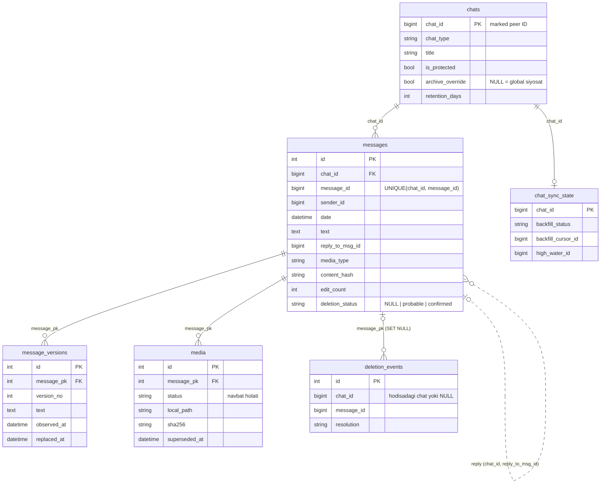

# 3-bosqich. Ma’lumotlar modeli

Kod: [models.py](../src/tgarchive/db/models.py), mantiq: [store.py](../src/tgarchive/db/store.py),
migratsiya: [0001](../src/tgarchive/migrations/versions/20261025_0001_initial_schema.py).

## 1. ER diagramma



Qo‘shimcha: `audit_log` (umumiy audit) va `component_heartbeats` (holat) — boshqa jadvallarga bog‘lanmagan.
`messages_fts` — FTS5 virtual jadvali, triggerlar orqali `messages.text` bilan sinxron.

## 2. Alohida jadvallar kerakmi? — baho

| Jadval | Kerakmi | Sabab |
|---|---|---|
| `chats` | Ha | Chat nomi/turi har xabarda takrorlanmasin; per-chat siyosat (arxiv, media, retention) |
| `messages` | Ha | Asosiy jadval, joriy holat |
| `message_versions` | Ha | Tahrirda eski holat **almashtirilmaydi**; ko‘p xabar tahrirlanmaydi, shuning uchun versiyalarni alohida saqlash joyni tejaydi |
| `media` | Ha | Fayl metama’lumoti + yuklab olish navbati (status, attempts, next_attempt_at) bitta joyda; alohida navbat xizmati kerak emas |
| `chat_sync_state` | Ha | Har chat uchun mustaqil checkpoint va xato holati |
| `deletion_events` | Ha | O‘chirishlar uchun alohida audit (talab 5): har hodisa, hatto arxivda nusxa bo‘lmasa ham |
| `audit_log` | Ha | Bot buyruqlari, ruxsatsiz urinishlar, eksport, retention |
| `component_heartbeats` | Ha | `/status` va healthcheck; bot archiver bilan to‘g‘ridan-to‘g‘ri gaplashmaydi |
| `app_meta` (0002) | Ha | Bazani bitta akkauntga bog‘lash (`account_id`): shaxsiy chat ID'larining noyobligi va o‘chirishlarni to‘g‘ri talqin qilish shunga tayanadi |
| `senders` (foydalanuvchilar) | **Hozircha yo‘q** | Xabarda `sender_id` + o‘sha vaqtdagi `sender_name` yetarli; muallif bo‘yicha qidiruv ID bilan. Kerak bo‘lsa keyinroq qo‘shiladi |
| `import_runs` | **Yo‘q** | `chat_sync_state` + `audit_log` yetarli |

## 3. Kalitlar va dublikatlar

- `chats.chat_id` — Telethon **marked peer ID**: foydalanuvchi `123`, oddiy guruh `-123`, kanal/superguruh `-100123`. Turli turdagi ID'lar to‘qnashmaydi.
- `messages`: ichki `id` (FTS va FK uchun) + **`UNIQUE(chat_id, message_id)`**. Bir xil xabar qayta kelsa (tarix + real vaqt, qayta urinish, gap-fill) — yangi qator yaratilmaydi.
- Barcha vaqtlar UTC'da (`UTCDateTime`); timezone'siz qiymat xato hisoblanadi.

## 4. Tahrirlar: versiyalash algoritmi

`content_hash` = sha256(matn, formatlash entity'lari, media ID'si (fayl bo‘lsa), servis harakati).
Ko‘rishlar soni, reaksiyalar, inline tugmalar hisobga olinmaydi — ular tahrir emas.

```
kelgan nusxa (record) uchun:
  bazada yo'q             -> INSERT                                  => CREATED
  hash bir xil            -> faqat yetishmagan maydonlarni to'ldirish => UNCHANGED
  hash farqli:
    bazadagi edit_date bor va (kelganda yo'q yoki eskiroq)
                          -> hech narsa o'zgarmaydi                   => STALE
    aks holda             -> joriy holatni message_versions ga nusxalash
                             (version_no = edit_count + 1),
                             messages ni yangilash, edit_count += 1   => EDITED
```

- `message_versions.observed_at` — shu holat birinchi ko‘rilgan vaqt, `replaced_at` — almashtirilgan vaqt. Shunday qilib har bir versiyaning "amal qilgan davri" ma’lum.
- Media almashtirilsa, eski `media` qatori `superseded_at` bilan belgilanadi va **o‘chirilmaydi** (yuklangan fayli bo‘lsa, u ham qoladi). Partial unique index: har xabarda ko‘pi bilan bitta joriy media.
- Cheklov: xabar arxivga tushishidan **oldin** tahrirlangan bo‘lsa, asl matn noma’lum; `edit_date` bor, lekin `message_versions` bo‘sh.

## 5. O‘chirilganlik holatlari

Hech qanday holatda `messages` qatori o‘chirilmaydi (retention bundan mustasno).

| `deletion_events.resolution` | Qachon | `messages.deletion_status` |
|---|---|---|
| `confirmed` | Hodisada chat aniq (kanal/superguruh) **yoki** `get_messages` tekshiruvi xabar yo‘qligini ko‘rsatdi | `confirmed` |
| `probable` | Chat ko‘rsatilmagan (shaxsiy/oddiy guruh), common box chatlari orasida **yagona** moslik | `probable` (agar oldin `confirmed` bo‘lmasa) |
| `ambiguous` | Bir nechta nomzod — **hech biri belgilanmaydi** | o‘zgarmaydi |
| `not_archived` | Arxivda nusxa yo‘q (xabar biz ko‘rmasdan oldin o‘chgan yoki doiradan tashqarida) | — |
| `revoked` | Belgilangan xabar keyin yana Telegram'dan olindi (va bu nusxa o‘chirishdan **keyin** olingan) | `NULL` ga qaytariladi |

"Tasdiqlangan / ehtimoliy / aniqlanmagan" talabiga moslik: `confirmed` / `probable` / (`ambiguous` + `not_archived`).

Nega shaxsiy chat hodisasi `probable`, `confirmed` emas? Telegram hujjatiga ko‘ra common box ID'lari akkaunt doirasida noyob, ya’ni bitta akkauntli bazada moslik deyarli aniq. Ammo Telegram chatni **o‘zi aytmagan**, shuning uchun biz uni xulosa sifatida belgilaymiz va 7-bosqichda `get_messages` tekshiruvi bilan `confirmed` ga ko‘taramiz.

Kanal hodisasi boshqa kanalga hech qachon bog‘lanmaydi (chat_id bo‘yicha qat’iy filtr), common box hodisasi kanal xabarlariga hech qachon bog‘lanmaydi (chat turi bo‘yicha filtr) — testlar: [test_store_deletions.py](../tests/test_store_deletions.py).

## 6. Reply zanjiri

- Saqlanadi: `reply_to_msg_id`, `reply_to_peer_id` (faqat **boshqa** chatdagi xabarga reply bo‘lsa; o‘z chatiga teng bo‘lsa `NULL` ga normallashtiriladi), `reply_to_top_id` (forum mavzusi).
- FK **qo‘yilmagan**: reply qilingan xabar hali import qilinmagan (tarix yangidan eskiga ketadi), o‘chirilgan yoki doiradan tashqarida bo‘lishi mumkin. Bog‘lanish so‘rov vaqtida join bilan topiladi — ota xabar keyinroq kelsa, bog‘lanish avtomatik "tiklanadi".
- Funksiyalar: `get_reply_parent`, `get_reply_chain` (sikldan himoyalangan, chuqurlik cheklangan), `get_replies`.

## 7. Import checkpoint (`chat_sync_state`)

| Maydon | Ma’nosi |
|---|---|
| `backfill_status` | `pending → running → done` yoki `failed` (keyin qayta urinish) yoki `disabled` |
| `backfill_boundary_id` | Backfill boshlanganda chatdagi eng yangi xabar ID'si |
| `backfill_cursor_id` | Keyingi sahifa shu ID'dan **kichik** xabarlarni oladi (`offset_id`) |
| `backfill_imported` | Statistika uchun hisoblagich |
| `high_water_id` | Shu ID'gacha hamma narsa olingani tasdiqlangan; gap-fill shu yerdan yuqoriga |
| `attempts`, `last_error`, `next_retry_at` | Xato bo‘lgan chatni boshqalardan mustaqil qayta ishlash |
| `remote_top_id` (0003) | Dialoglar ro‘yxatida ko‘rilgan eng yangi ID; `> high_water_id` bo‘lsa chatda yangi xabar bor |
| `last_refresh_at` (0003) | Oxirgi oldinga sinxronlash yoki kanal oynasi yangilangan vaqt |

0003 migratsiyasining boshqa maydonlari: `chats.linked_chat_id` — kanalning muhokama (izoh) guruhi;
`messages.comments_synced_id` — kanal posti izohlari shu ID'gacha olingan; indeks `ix_messages_reply_peer` —
boshqa chatdan qilingan reply'larni topish (kanal oynasidan chiqarishda reply qilingan postni himoyalash).
Batafsil: [06-history.md](06-history.md).

## 8. Media

Fayllar **bazaga emas**, fayl tizimiga (`MEDIA_DIR`) yoziladi. Sabablar: SQLite fayli kichik qoladi (zaxira, VACUUM tez), fayllarni alohida tekshirish va tozalash oson, kerak bo‘lsa obyekt saqlashga (S3) ko‘chirish mumkin.

Bazada: nisbiy `local_path`, `stored_size`, `sha256`, `mime_type`, Telegram identifikatorlari (`tg_media_id`, `tg_access_hash`, `tg_dc_id`). `file_reference` **saqlanmaydi** — u eskiradi; yuklashdan oldin xabar qayta olinadi.

Holatlar: `pending → downloading → done`, yoki `failed` (urinishlar tugadi), `skipped` (sabab `skip_reason` da: `too_large` — katta fayl, `type`, `policy`, `protected`, `view_once`), `missing` (diskda yo‘q / checksum mos emas — qayta yuklanadi), `unavailable` (Telegram'da yo‘q).

0004 migratsiyasi: `media.skip_reason`, `media.force_download` (egasi `tgarchive media fetch` bilan so‘ragan), `media_trash` (arxivdan olib tashlangan xabarlarning o‘chiriladigan fayllari). Batafsil: [08-media.md](08-media.md).

## 9. To‘liq matnli qidiruv (FTS5)

- `messages_fts` — **contentless** FTS5 (matn nusxasi saqlanmaydi, faqat indeks), `unicode61 remove_diacritics 2` tokenizer: lotin va kirill, katta-kichik harf farqsiz.
- O‘zbekcha tutuq belgisi: `o'`, `o‘`, `oʻ`, `o’`, `` o` `` — hammasi indeksda ham, so‘rovda ham `'` ga keltiriladi. Python va SQL normallashtirish bir xilligi test bilan tekshiriladi.
- So‘rov xavfsizligi: har bir so‘z qo‘shtirnoqqa olinadi, `AND/OR/NOT/NEAR`, qavslar, `*` operator sifatida ishlamaydi. Parametr bound — SQL injection yo‘q.
- Sukut bo‘yicha **so‘z boshi** bo‘yicha qidiruv: `kitob` → `kitoblarimizni` (o‘zbek tilidagi qo‘shimchalar uchun muhim).
- Triggerlar: INSERT, UPDATE OF text, DELETE. Tahrirdan keyin eski so‘zlar indeksdan chiqadi; o‘chirilgan deb belgilangan xabarlar qidiruvda qoladi.
- Cheklov: stemming yo‘q (`kitobim` so‘rovi `kitoblar` ni topmaydi). Keyingi migratsiyada `messages` jadvali batch rejimida qayta yaratilsa, FTS triggerlarini qayta yaratish shart (migratsiya faylida ogohlantirish bor).

## 10. Indekslar va ular xizmat qiladigan so‘rovlar

| Indeks | So‘rov |
|---|---|
| `uq_messages_chat_id_message_id` | dublikat tekshiruvi, chat ichida xabar, `chat_id` FK |
| `ix_messages_chat_date` | chat bo‘yicha + sana oralig‘i, eksport |
| `ix_messages_date` | `/recent`, global sana filtri |
| `ix_messages_sender_date` | muallif bo‘yicha filtr |
| `ix_messages_message_id` | chatsiz o‘chirish hodisasi (common box) |
| `ix_messages_reply` (partial) | "shu xabarga javoblar", reply mavjudligi |
| `ix_messages_media_type_date` (partial) | media turi bo‘yicha |
| `ix_messages_edit_date` (partial) | tahrirlangan xabarlar |
| `ix_messages_deleted_at` (partial) | `/deleted` |
| `uq_media_current` (partial unique) | har xabarda bitta joriy media |
| `ix_media_queue` | yuklab olish navbati |
| `ix_media_message_pk`, `ix_deletion_events_message_pk` | FK cascade / SET NULL tezligi |

## 11. Saqlash muddati va kanal oynasi

**Shaxsiy ma’lumotlar doimiy saqlanadi** (egasi qarori): `RETENTION_DAYS` bo‘sh. Mexanizm 10-bosqichda
qo‘shilgan ([db/retention.py](../src/tgarchive/db/retention.py), `tgarchive retention set`). Agar yoqilsa, muddati o‘tgan xabarlar, ularning versiyalari, media qatorlari va **fayllari** o‘chiriladi;
`audit_log` ga faqat sonlar yoziladi (mazmun emas). Xuddi shu fayl boshqa xabar tomonidan ishlatilsa
(`tg_media_id` bir xil), fayl saqlanib qoladi.

**Kanallar — aylanma oyna** (`chats.archive_mode = window`, `CHANNEL_KEEP_POSTS=20`):

- Kanalning o‘zidagi postlardan faqat eng yangi 20 tasi saqlanadi; yangi post kelganda oynadan chiqqan eng eski post arxivdan olib tashlanadi (7-bosqich).
- **Istisno — reply qilingan postlar:** arxivdagi biror xabar (masalan, shaxsiy chatdagi) shu postga reply qilgan bo‘lsa, post oynadan chiqsa ham saqlanadi.
- **Izohlar oynaga bog‘liq emas:** ular muhokama guruhi chati ostida saqlanadi va doimiy. Guruhda kanal postining nusxasi ham bor, shuning uchun izohlar konteksti yo‘qolmaydi.
- Oynadan chiqarish `audit_log` ga yoziladi (post ID'lari, mazmunsiz).

`chats.archive_mode` (0002) — archiver oxirgi marta qo‘llagan siyosat (`full` / `window` / `skip`); bot uni faqat ko‘rsatadi.
